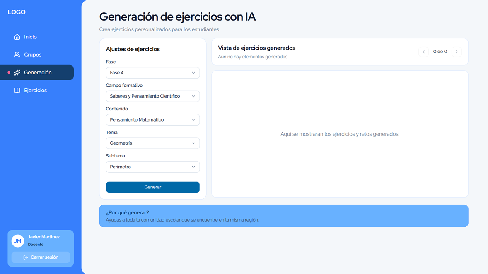

# STI-NEM

**A collaborative intelligent tutoring project for learning aligned with Mexico’s New Mexican School framework.**

STI-NEM is an academic project exploring an AI-assisted tutor for primary-school learning. The project is described as a master’s thesis collaboration at Tecnológico Nacional de México. This showcase focuses on the teacher-facing frontend work attributed to my contribution.

## Objective

Provide a teacher-facing experience for organizing groups and configuring learning activities as part of a broader tutoring system.

## My contribution

**Frontend development, primarily the teacher module**

- Developed teacher-facing screens for group and classroom workflows.
- Contributed interface views related to student learning and exercise configuration.
- Worked within a collaborative project; this showcase does not claim ownership of the full system, backend, or AI models.

## Screenshots

The exercise screenshot documents a criteria form only. Its results area is empty, so it is not evidence of a working AI generation service.

## Technology and architecture

The supplied frontend architecture document reports **Next.js 16.3.1, React 19.2, TypeScript (strict), Tailwind CSS 4, shadcn/ui / Base UI, Lucide, Zod, Server Actions, and fetch**. The source repositories were not accessible during this review, so these technologies and the documented service integrations are **not independently verified against source code**.

The architecture notes describe a role-aware frontend and a boundary between UI actions and service calls. This is a description from project documentation, not confirmation that every integration is implemented or deployed.

## Project links

- [Developer portfolio repository](https://github.com/Tecomahua/javier-martinez-portfolio)

## Source, collaboration, and privacy

This public repository contains documentation and one reviewed screenshot only. It does not include source code, private configuration, endpoints, student records, credentials, Git history, or third-party assets. The collaborative implementation repositories were not available for source verification; please consult the project team for implementation access and attribution details.
